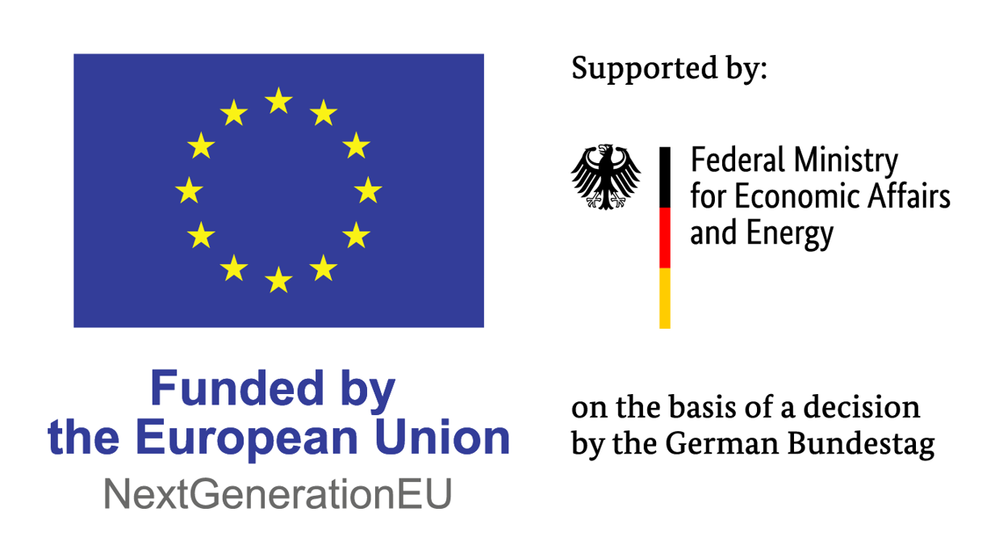

# EWBI Federation Platform

## About the Project

The EWBI Federation Platform is an open-source project developing software to support federation between independent operator platforms. It implements a subset of the **GSMA Operator Platform Group (OPG) East-Westbound Interface (EWBI)**, providing a common interface for exchanging federation information and coordinating operations across operator environments.

The project aims to support interoperable edge-to-cloud services while allowing each operator to retain control of its own infrastructure and operational systems.

For the GSMA interface specification, see the [East-Westbound Interface APIs](https://www.gsma.com/solutions-and-impact/technologies/networks/gsma_resources/east-westbound-interface-apis-version-6-0/).

## Project Scope

This repository contains two main software components:

- **OPG EWBI API** — provides the REST interface used for communication between federated operator platforms.
- **OPG EWBI Operator** — manages federation-related Kubernetes resources and connects them to federation operations.

The software provides the federation interface and the Kubernetes representation of federation resources. It does not, by itself, provide a complete end-to-end edge orchestration solution. Operators are expected to integrate it with their own resource management systems or orchestrators, which carry out platform-specific workload operations.

The project implements a subset of EWBI and is under active development. Not all functionality described by the wider GSMA interface specification should be assumed to be implemented.

## Project Status

> ⚠️ **Under development**
>
> This solution is a work in progress. Interfaces, behaviour and deployment instructions may change as the project develops.

## Documentation

The documentation covers the platform architecture, implementation, federation behaviour, security and deployment.

- **[Quick Start Guide](docs/Quick-start-introduction.md)** — introduction to the federation concepts and platform.
- **[High-Level Architecture](docs/architecture.md)** — the major platform components and their relationships.
- **[Core Components](docs/components.md)** — component responsibilities and implementation details.
- **[Federation Model and Workflows](docs/federation.md)** — federation behaviour, resource relationships and operational workflows.
- **[Security](docs/security.md)** — security mechanisms and trust boundaries.
- **[Deployment Guide](docs/deployment.md)** — prerequisites and instructions for building and deploying the Federation Manager.
- **[Manual Federation Testing with Kind](docs/manual-testing-kind.md)** — local end-to-end federation testing.
- **[Manual Callback Testing with Kind](docs/manual-callbacks-testing-kind.md)** — local testing of the callback flow.

## Contributing

Please read [CONTRIBUTING.md](CONTRIBUTING.md) before opening a pull request.

Contributions must follow the project's contribution requirements, including conventional commit messages and the pull request template. Please use GitHub issues to discuss problems or proposed changes, and submit pull requests for agreed fixes or improvements.

## Funding and Support

This open-source project is part of activities carried out within the **Important Project of Common European Interest on Next Generation Cloud Infrastructure and Services (IPCEI-CIS)**, an EU initiative to build a sovereign, interoperable and energy-efficient cloud-to-edge infrastructure in Europe.

=======

  

