# Federation Model and Workflows

This document describes how federation operations are performed between participating operators.

It covers the lifecycle of a federation relationship, the relationships between federation resources, how application deployments are requested and executed, and how status information is propagated between operators.

For the architecture and implementation of the individual components, see [Architecture](architecture.md) and [Core Components](components.md).

---

# Federation Model

A federation relationship connects two independent operator platforms.

The operator requesting access to a partner's capabilities acts as the **Guest**, while the operator providing those capabilities acts as the **Host**.

The relationship is associated with a unique **Federation Context ID**. This identifier is used to associate subsequent federation operations with the correct relationship.

The federation lifecycle progresses from establishing the relationship to selecting Availability Zones, onboarding application resources, requesting deployments and exchanging status updates.

The following diagram provides a high-level overview of this lifecycle.

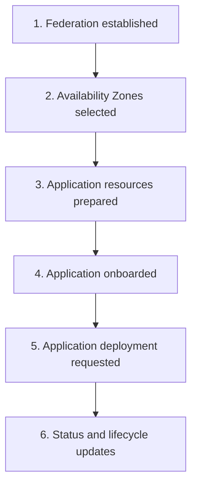

This diagram describes the overall progression of federation operations. The relationships between the individual resources are described in the [Federation Resource Model](#federation-resource-model) section.

---

# End-to-End Federation Workflow

A typical application deployment progresses through three broad stages:

1. Establishing the federation relationship.
2. Accepting an Availability Zone offered by the Host.
3. Preparing, onboarding and deploying the application.

The following diagram provides a simplified end-to-end view of these stages and the operations involved.

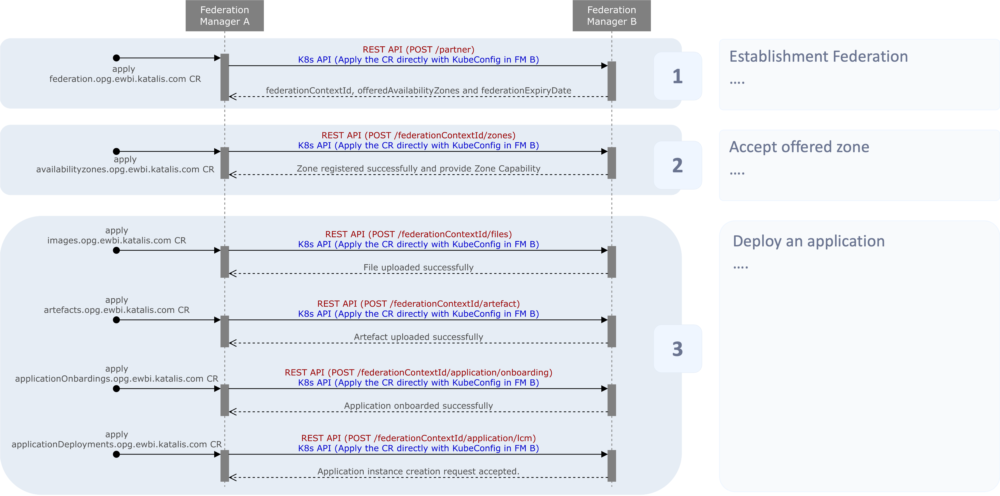

## Federation Registration

Federation registration establishes the relationship between the Guest and Host.

The Guest initiates the process by creating a federation request. The request contains the information required to identify the originating operator and establish communication with the partner.

The Host receives the request, creates the corresponding federation state and provides the information required for the Guest to continue the federation process.

The Guest then stores the resulting federation information locally.

At a high level:

1. The Guest initiates federation.
2. The request is sent to the Host.
3. The Host creates the federation relationship.
4. The Host returns the Federation Context ID and available federation information.
5. The Guest records the resulting federation state.

### Federation registration sequence

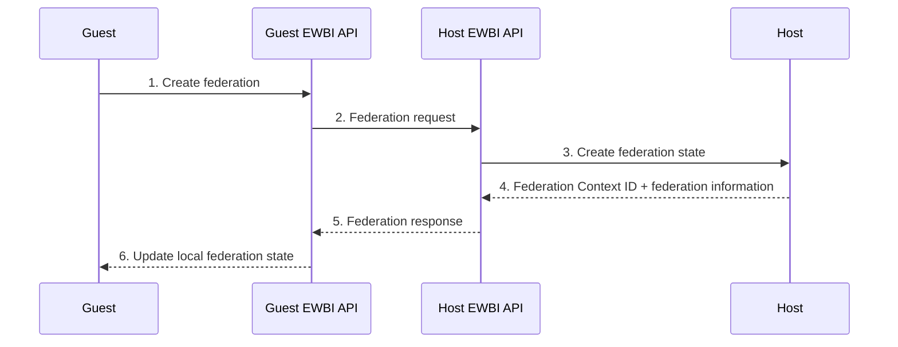

The Federation Context ID is then used by subsequent federation operations to identify the relationship.

---

## Availability Zone Subscription

After federation has been established, the Host can make Availability Zones available to the Guest.

An Availability Zone represents a partner site or location where an application can run.

The Guest receives information about the zones offered by the Host and can select the zones it wishes to use. The Host then records the zones accepted by the Guest.

The basic interaction is:

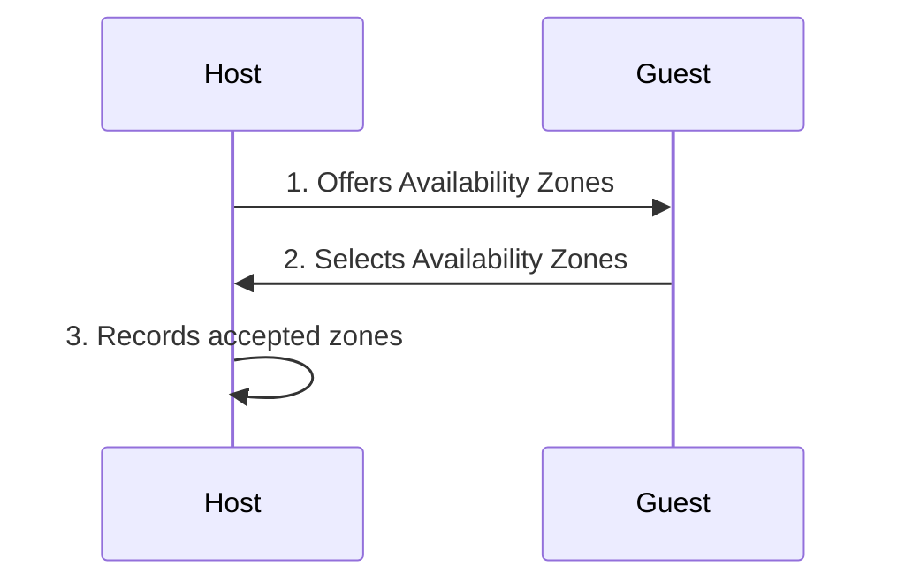

The selected Availability Zones can subsequently be associated with applications and used to identify the target location for each deployment.

---

# Federation Resource Model

## Resource Definitions

The federation uses several related resources to represent the operator relationship, the content needed to deploy an application, and the locations where it can run.

Each resource has a specific role:

### Federation

A Federation represents the relationship between the originating operator (Guest) and the partner operator (Host). It establishes the federation context and provides the `federationContextId` used to associate subsequent federation operations and resources with the correct relationship.

### Availability Zone

An Availability Zone represents a site or location offered by the Host where an application can run. The Guest can select from the zones offered by the Host when preparing an application for deployment.

### Image

An Image represents deployable application content registered within the federation, such as a container image or virtual machine image.

### Artefact

An Artefact describes a deployable package, such as a Helm chart, and the Images it requires.

### ApplicationOnboarding

An ApplicationOnboarding represents an application that is being onboarded into the federation. It identifies the Artefacts required by the application and the Availability Zones in which it can run.

### ApplicationDeployment

An `ApplicationDeployment` represents a requested or running deployment of an onboarded application in a specific Availability Zone. The Host's local orchestration platform is responsible for executing the actual workload deployment.

## Resource Relationship
The diagram below describes the logical relationships between these resources. It is a relationship diagram, not a workflow: the connections indicate how resources are associated with one another, rather than the order in which federation operations occur.

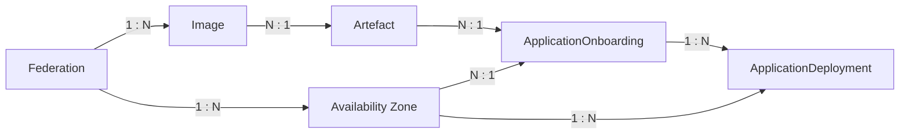

## Resource Relationships

The cardinalities in the diagram describe the expected logical relationships between resources.

| Relationship | Cardinality | Meaning |
|---|---|---|
| Federation → Availability Zone | One to many | A federation can include multiple partner sites. |
| Federation → Image | One to many | A federation can include multiple registered images. |
| Image → Artefact | Many to one | Multiple images can belong to one artefact. |
| Artefact → ApplicationOnboarding | Many to one | Multiple artefacts can be referenced by one application. |
| Availability Zone → ApplicationOnboarding | Many to one | An application onboarding can be associated with multiple Availability Zones. |
| ApplicationOnboarding → ApplicationDeployment | One to many | An application onboarding can have multiple deployments. |
| Availability Zone → ApplicationDeployment | One to many | An Availability Zone can host multiple deployments. |

The relationships can also be read in the reverse direction:

- Each `ApplicationDeployment` refers to one Application Onboarding.
- Each `ApplicationDeployment` targets one Availability Zone.
- An `ApplicationOnboarding` references the Artefacts it requires and the Availability Zones in which it can run.
- An `Artefact` identifies the Images it requires.

These relationships explain how the resources fit together, independently of the operations used to create, exchange or update them.

# Application Onboarding

Application onboarding makes an application available within the federation so that it can subsequently be deployed.

The Guest provides the Host with the application information and the Artefacts required to support the application. Those Artefacts identify the Files required by the application.

The Host creates the corresponding local application representation and processes the onboarding request.

The basic flow is:

1. Application resources are prepared by the Guest.
2. The Guest sends the application information to the Host.
3. The Host records the application in its local platform.
4. The Host processes the application onboarding operation.
5. The Host notifies the Guest if the application has been onboarded successfully.

### Application onboarding sequence

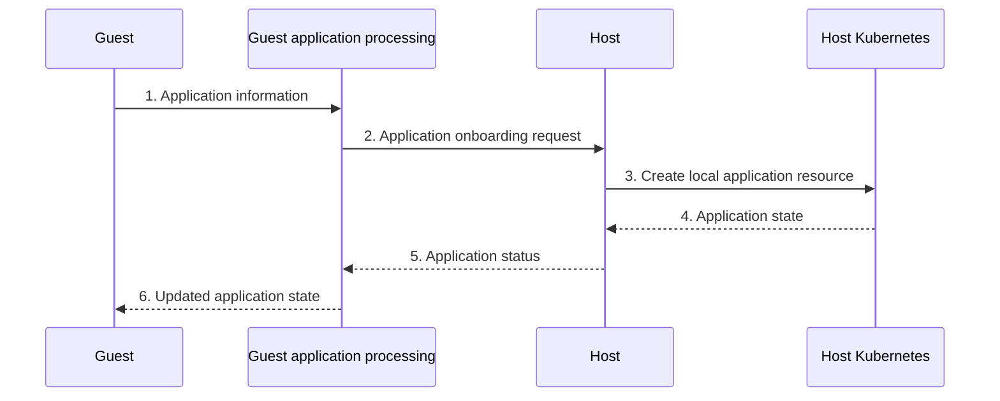

Once onboarded, an Application can be used to create one or more `ApplicationDeployment` resources, each targeting a specific Availability Zone.

---

# Application Deployment

Application deployment begins when the Guest requests an `ApplicationDeployment` for an onboarded Application.

The Guest identifies the ApplicationOnboarding and the Availability Zone in which the deployment should run. Each `ApplicationDeployment` represents one deployment of one ApplicationOnboarding in one Availability Zone.

The request is sent to the Host through the federation interface.

On the Host, the deployment request is represented as a Kubernetes `ApplicationDeployment` resource.

This resource contains the information required to describe the requested deployment, including the Application, version, target Availability Zone and resource requirements.

The Host's local orchestration platform can then use this resource to perform the actual workload deployment.

The separation is important:

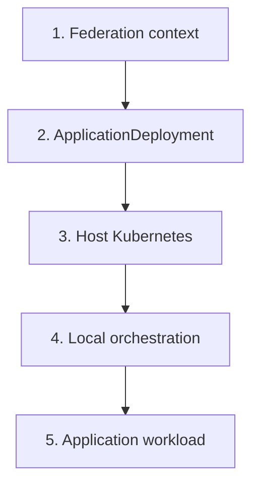

The federation layer coordinates the request, while the Host remains responsible for executing the workload using its own platform.

### Application deployment sequence

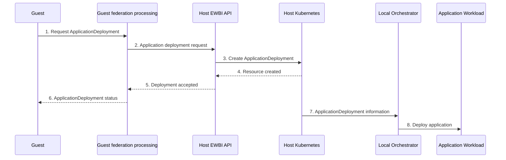

The exact interaction between the Host Kubernetes environment and the local orchestration platform depends on the operator's implementation.

---

# Reconciliation and State Synchronisation

Federation resources have both a requested state and an observed state.

The requested information describes what the operator wants to happen. The observed state records the current state of the federation operation.

This allows federation operations to progress asynchronously rather than requiring the original request to remain open until the operation has completely finished.

For example, an application may initially be in the `PENDING` state and subsequently become `ONBOARDED`.

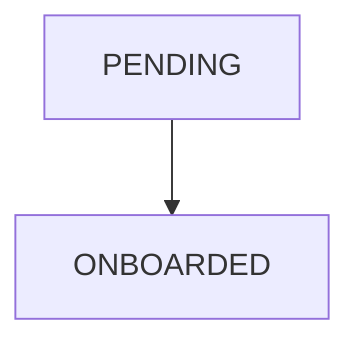

An `ApplicationDeployment` can move from `PENDING` to `READY` when the deployment is ready.

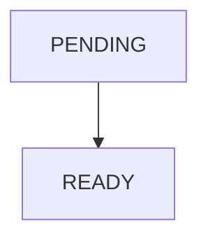

If the operation encounters an error, the resource may instead enter a `FAILED` state.

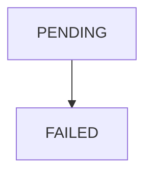

An ApplicationDeployment may also enter `TERMINATING` when it is being removed.

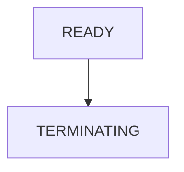

The Guest and Host each maintain their own local representation of the relevant federation resources. Status information is propagated between the operators so that the Guest can observe changes occurring on the Host.

---

# Federation Expiry and Locking

A Federation has an expiry date that controls how long the federation relationship remains available for operations.

When a Host-side Federation is created, its initial expiry date is set to 24 hours after its initial date. A renewal date is set to 23 hours after the initial date.

At the renewal date, the expiry is extended once by a further 24 hours. If the Federation subsequently expires, its state becomes `LOCKED`.

While a Federation is not in the `AVAILABLE` state, its child resources are not reconciled. This prevents normal processing of those resources while the Federation is unavailable.

When testing or creating sample Federation resources, ensure that `initialDate` is appropriate for the intended lifecycle. Reusing an old initial date can cause the Federation to reach expiry and become `LOCKED` almost immediately.

---

# Event and Callback Model

Many federation operations are asynchronous.

Instead of requiring the Guest to repeatedly query the Host for changes, the Host can send status information to a callback endpoint associated with the federation.

The general pattern is:

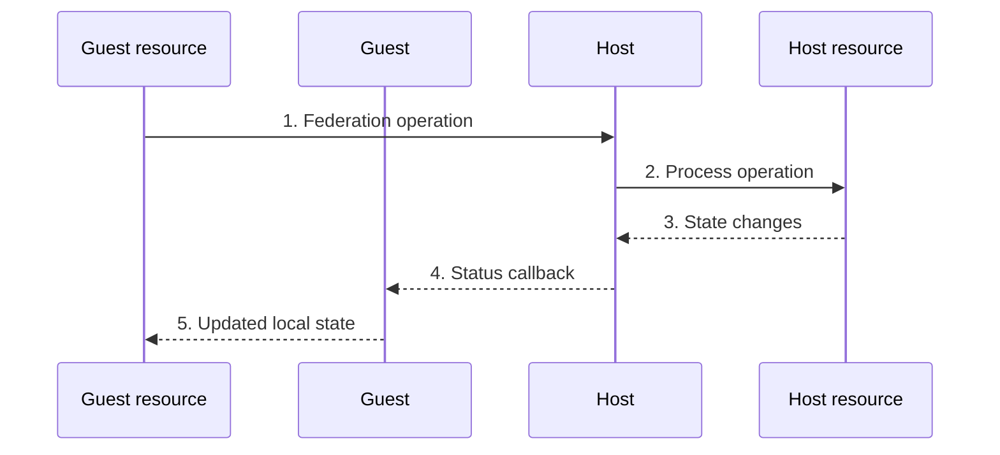

Callbacks can communicate changes associated with resources such as:

- ApplicationOnboardings
- ApplicationDeployments
- Images
- Artefacts
- Federation status

The callback information allows the receiving operator to update its local representation of the resource.

For example, when an ApplicationDeployment changes state, the Host can send the current state and access-point information to the Guest. The Guest can then update its local ApplicationDeployment resource.

---

# Status and Callback Model

## Callbacks

Callbacks communicate asynchronous status information from one operator to another.

This allows a federation operation to continue independently while the participating operators exchange status updates.

A simplified communication model is:

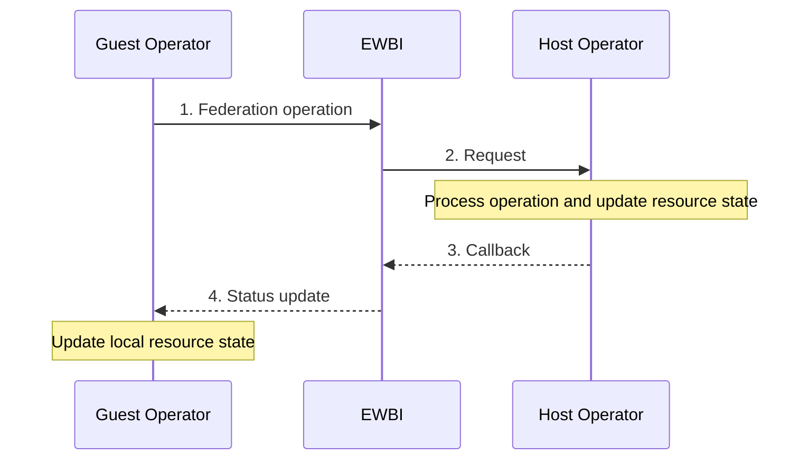

For details of how these interfaces are implemented, see [Core Components](components.md).

---

# Failure and Recovery

Federation operations can fail at different points in their lifecycle.

Examples include:

- Invalid federation or application information.
- A requested resource not being available.
- A communication failure between operators.
- A problem processing a workload.
- An ApplicationOnboarding or ApplicationDeployment being unable to reach its requested state.

When an operation fails, the corresponding federation resource records an error or failed state.

For example, applications can enter `FAILED`, while ApplicationDeployments can enter `FAILED` or `TERMINATING`, depending on the operation being performed.

Intermediate states such as `PENDING` allow an operation to remain active while processing is still in progress.

The resource state therefore provides the primary indication of whether an operation is progressing, has completed successfully, or has encountered a problem.

---

# Federation Lifecycle Summary

The complete lifecycle can be summarised as follows:

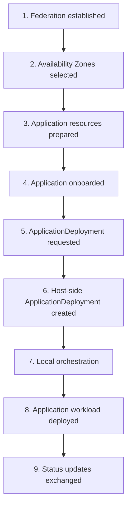

This lifecycle describes the progression from establishing a federation relationship to executing an application workload and exchanging status updates.

It is a simplified operational view, not a representation of direct resource dependencies. For example, an Application references both Artefacts and Availability Zones, while an ApplicationDeployment identifies one ApplicationOnboarding and one target Availability Zone.

The federation layer coordinates the relationship and exchanges information between operators, while each operator retains responsibility for its own local platform and workload execution.

---

## Related Documentation

* [Quick Start Guide](Quick-start-introduction.md) — Introduction to the platform and its key concepts.
* [Architecture](architecture.md) — Describes the high-level architecture of the EWBI Federation Platform
* [Core Components](components.md) — Detailed responsibilities and implementation of the platform components.
* [Security](security.md) — Security model and trust boundaries.
* [Deployment](deployment.md) — Setup and deployment of the federation manager